# Hello Connections!

I am Efra, an Informatics Engineering student and backend developer focused on building clean, high-performance server-side systems, especially within the Discord ecosystem.

Believe in keeping complexity under control through simplicity and modular design. My goal is to build reliable, maintainable services that stay fast as they grow.

> [!NOTE]
> Currently developing **Koda**, a Discord bot for server automation, alongside small-scale backend projects.

<table border="0">
<tr>
<td width="60%" valign="top">
<h2>Discord Profile Activity</h2>

Active in the Discord developer ecosystem, focusing on <b>high-performance automation</b> and <b>bot engineering</b>.

<ul>
<li><b>Building:</b> Developing the <b>Koda</b> Discord bot for custom server automation and utility.</li>
<li><b>Structuring:</b> Designing lightweight data persistence and backend APIs with <b>SQLite</b> and <b>SQL</b>.</li>
<li><b>Managing:</b> Running small-scale backend projects, server automation, and event-driven workflows.</li>
<li><b>Exploring:</b> Researching Linux system administration, network protocols, and process management.</li>
</ul>
</td>
<td width="40%" valign="top" align="center">

</td>
</tr>
</table>

  

## Tech Stack

  

## Let's Connect!~

  
  

  

